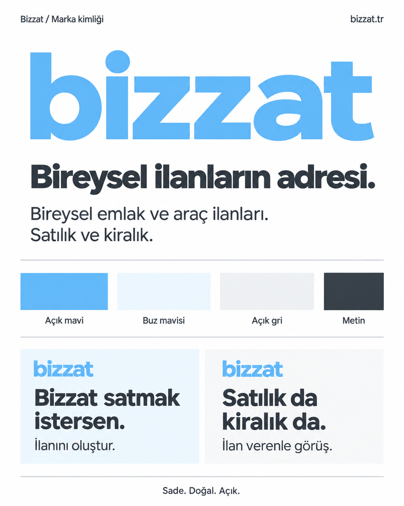

# Bizzat

**Bireysel ilanların adresi.**

Bizzat, emlakçı ve galerici ilanlarını dışarıda tutmayı amaçlayan; bireysel satılık ve kiralık emlak ve araç ilanlarına odaklanan bir platform projesidir.

Bu depo ürün kapsamını, marka kimliğini, Sahibinden referans envanterini, ilk MVP sınırlarını, teknik mimariyi ve çalışan uygulama foundation'ını içerir.



## Temel bilgiler

| Konu | Karar |
|---|---|
| Marka | Bizzat; yazı logosunda `bizzat` |
| Slogan | Bireysel ilanların adresi. |
| Uzun vadeli kategoriler | Emlak ve araç |
| İlk MVP kategorileri | Satılık Daire, Kiralık Daire, Satılık Otomobil |
| İlk istemci | Responsive web |
| MVP iletişim | Telefon odaklı; site içi mesajlaşma yok |
| EİDS | Production ilan yayını için yetki doğrulaması zorunlu kapı |
| Teknik mimari | Next.js + Fastify + Kysely + PostgreSQL 18; self-hosted modular monolith |
| Auth | Self-hosted Better Auth; email/password + cookie session |
| Roller | `public.profiles`: `user`, `moderator`, `admin` |
| Konum referansı | PostgreSQL içinde il → ilçe → mahalle; explicit snapshot import |
| Araç kataloğu | Bizzat-owned yaprak UUID kimliği; değişken derinlikte seçim ağacı; PostgreSQL runtime |
| Çalıştırma | pnpm workspace + Docker Compose; production tarafında tek Linux VM/VDS hedefi |
| Görsel yön | Açık mavi, beyaz ve açık tonlar; sade ve profesyonel |
| Mevcut aşama | Identity + konum + canonical araç katalog + otomobil ve daire ilan oluşturma/yayınlama/düzenleme + kendi ilanlarım + filtre/sıralamalı public feed/detay + ilan raporlama ve minimum moderasyon |

İlan veren kişinin her durumda malın kayıtlı sahibi olması markanın genel şartı değildir. Ancak güncel EİDS kuralları nedeniyle taşınmaz ve taşıt ilanlarında elektronik yayın yetkisi malik, eş ve izin verilen birinci/ikinci derece kan hısımlarıyla sınırlı bireysel bir yapıya sahiptir. Bizzat'ın “başkası adına yardımcı olma” yaklaşımı bu yasal/entegrasyon sınırı içinde uygulanmalıdır.

## İlk MVP

İlk çalışan sürüm uçtan uca ilan döngüsünü şu üç ilan türüyle doğrulayacak:

- Emlak → Konut → Daire → Satılık
- Emlak → Konut → Daire → Kiralık
- Araç → Otomobil → Satılık

Ana sayfa, liste/filtreleme, ilan detayı, auth, ilan oluşturma, EİDS/yetki kapısı, kendi ilanlarını yönetme, telefonla iletişim, ilan raporlama ve minimum moderasyon MVP kapsamındadır. Favori, site içi mesajlaşma, ödeme/abonelik, doping, ekspertiz, rezervasyon, native mobil uygulama ve profesyonel mağazalar kapsam dışıdır.

Ayrıntı: [docs/MVP_SCOPE.md](docs/MVP_SCOPE.md).

## İlan akışları

### Otomobil

Otomobil dikey dilimi çalışır durumdadır:

- `/ilan-ver/otomobil` altında canonical araç seçimi, ilan bilgileri ve fotoğraf yükleme,
- `/ilanlarim` üzerinde kullanıcının kendi taslak, yayın ve pasif ilanlarını görüp yönetmesi; taslak/yayında/pasif ilanları düzenleyebilmesi,
- yayınlama ve yayından kaldırma; yayın öncesi zorunlu alan ve en az bir fotoğraf kontrolü,
- EİDS yetki doğrulaması için provider adapter sınırı,
- ana sayfa ve `/otomobil` üzerinde public otomobil feed’i; `/otomobil` üzerinde URL query state’li filtre paneli ve sıralama,
- `/otomobil/:listingId` üzerinde public ilan detayı, fotoğraf galerisi ve araç özellikleri,
- ilan sahibinin telefon görünürlüğü tercihine saygılı “Telefonu göster” akışı,
- public ilan detayında “İlanı raporla” formu,
- `/moderasyon/raporlar` üzerinde moderatör rapor kuyruğu, not girme, raporu reddetme ve ilanı yayından kaldırma.

### Daire

Satılık ve kiralık daire dikey dilimi çalışır durumdadır:

- `/ilan-ver/daire` altında işlem türü seçimi, daire bilgileri, konum, iletişim ve fotoğraf yükleme,
- `/ilan-ver/daire?draft=<id>` ile taslak/yayındaki/pasif ilan düzenleme,
- `/daire` üzerinde satılık/kiralık geçişli public feed; konum, fiyat, oda sayısı, m², bina yaşı, ısıtma, otopark, eşyalı ve site filtreleri; fiyat/m² sıralaması,
- `/daire/:listingId` üzerinde public detay, fotoğraf galerisi, daire özellikleri ve telefonu gösterme akışı,
- `/ilanlarim` üzerinde daire taslaklarını/yayındaki/pasif ilanları düzenleme, yayınlama ve yayından kaldırma.

Satılıkta krediye uygunluk ve takas; kiralamada depozito alanı işlem türüne bağlıdır. Yayın öncesi daire bilgileri, aktif konum, telefon ve en az bir fotoğraf kontrol edilir. Yayındaki ilan düzenlendiğinde `published` durumu korunur; yayındaki ilanın son fotoğrafı kaldırılamaz.

Public API yüzeyi:

- `GET /api/v1/listings/public/car-sale` — cursor pagination’lı feed
- `GET /api/v1/listings/public/car-sale/:listingId` — ilan detayı
- `GET /api/v1/listings/public/car-sale/:listingId/contact` — yalnız `showPhone` açıksa telefon
- `GET /api/v1/listings/public/images/:imageId` — işlenmiş kart görseli
- `GET /api/v1/listings/public/images/:imageId/full` — işlenmiş detay görseli
- `GET /api/v1/listings/public/apartment` — `transactionType=sale|rent` daire feed’i
- `GET /api/v1/listings/public/apartment/:listingId` — daire detayı
- `GET /api/v1/listings/public/apartment/:listingId/contact` — yalnız `showPhone` açıksa telefon

Otomobil feed filtreleri: `brandId`, `seriesId`, `modelId`, `provinceId`, `districtId`, `minPrice`, `maxPrice`, `minYear`, `maxYear`, `minMileageKm`, `maxMileageKm`, `fuelType`, `transmission`, `bodyType`, `drivetrain`, `vehicleCondition`, `color`, `q`, `swapAvailable`, `listedWithinDays`. Sıralamalar: `newest` (varsayılan), `oldest`, `price_asc`, `price_desc`, `mileage_asc`, `mileage_desc`, `year_asc`, `year_desc`.

Daire feed filtreleri: `transactionType`, `provinceId`, `districtId`, `minPrice`, `maxPrice`, `roomCount`, `minGrossM2`, `maxGrossM2`, `minBuildingAge`, `maxBuildingAge`, `minFloor`, `maxFloor`, `heating`, `bathroomCount`, `furnished`, `inSite`, `parking`, `creditEligible`, `swapAvailable`, `q`, `listedWithinDays`. Sıralamalar: `newest`, `oldest`, `price_asc`, `price_desc`, `gross_m2_asc`, `gross_m2_desc`. Her iki feed’de cursor seçilen sıralama ve filtrelere göre üretilir; aynı cursor farklı sıralama veya filtreyle reddedilir.

Authenticated yönetim yüzeyi:

- `GET /api/v1/me/listings` — kullanıcının otomobil ilanları ve durumları
- `GET /api/v1/listings/:listingId` — otomobil düzenleme görünümü
- `PATCH /api/v1/listings/:listingId/car-sale/details` — otomobil bilgilerini kaydeder
- `POST /api/v1/listings/:listingId/images` — otomobil fotoğrafı yükler
- `POST /api/v1/listings/:listingId/publish` — otomobil taslağını/pasif ilanını doğrulama sonrası yayınlar
- `POST /api/v1/listings/:listingId/unpublish` — yayındaki otomobil ilanını pasife alır
- `GET /api/v1/me/apartment-listings` — kullanıcının daire ilanları ve durumları
- `GET /api/v1/listings/:listingId/apartment` — daire düzenleme görünümü
- `POST /api/v1/listings/apartment/drafts` — `{ transactionType: sale|rent }` taslak oluşturur
- `PATCH /api/v1/listings/:listingId/apartment-details` — daire bilgilerini kaydeder
- `POST /api/v1/listings/:listingId/apartment/images` — daire fotoğrafı yükler
- `POST /api/v1/listings/:listingId/apartment/publish` — daire ilanını doğrulama sonrası yayınlar
- `POST /api/v1/listings/:listingId/apartment/unpublish` — yayındaki daire ilanını pasife alır

Raporlama ve moderasyon yüzeyi:

- `POST /api/v1/listings/:listingId/reports` — public ilan için ziyaretçi veya üye raporu
- `GET /api/v1/moderation/reports` — moderatör/admin rapor kuyruğu
- `PATCH /api/v1/moderation/reports/:reportId` — `reject` veya `dismiss` kararı ve moderasyon notu

Rapor nedenleri: `fraud`, `wrong_category`, `prohibited`, `duplicate`, `misleading`, `other`. Rapor durumları: `open`, `reviewing`, `resolved`, `dismissed`. Moderatör ilanı reddettiğinde ilan `rejected` durumuna geçer, public okumalardan kalkar ve sahibi tarafından doğrudan yeniden yayınlanamaz; o ilana ait açık raporlar birlikte kapatılır. Moderatör işlemi `reviewed_by_user_id`, `reviewed_at` ve `resolution_note` alanlarına yazılır. Moderatör/admin rolü public sign-up’tan gelmez; `profiles.role` server-owned olarak yönetilir.

Telefon numarası detay yanıtına konmaz; yalnız açık kullanıcı tercihi varsa ayrı contact endpoint’inden döner. Public görseller metadata’dan arındırılmış WebP varyantlarıdır.

EİDS doğrulaması `VerificationProvider` sınırı arkasındadır; otomobil için `vehicle_authority`, daire için `property_authority` kontrolü çalışır. Local/test ortamında explicit `EIDS_PROVIDER=mock` kullanılabilir. Production’da mock provider reddedilir; gerçek provider yoksa veya doğrulama başarısız/kullanılamazsa ilan yayınlanmaz (`fail closed`). Her deneme `verification_checks` tablosuna minimal sonuç olarak yazılır; ham provider yanıtı saklanmaz.

Düzenleme yalnız `draft`, `published` ve `inactive` ilanlarda açıktır; `rejected` ile doğrulama/inceleme bekleyen ilanlar düzenlenemez. Henüz bu dilimde olmayanlar: daire filtrelerinin URL query state’ine taşınması, rapor rate limit’i, moderasyon SLA/itiraz akışı ve gerçek EİDS provider entegrasyonu. Geliştirme ortamında otomobil feed’ini doldurmak için:

```bash
pnpm listings:seed:dev -- <owner-user-uuid>
```

## Teknik foundation

- `apps/web`: Next.js responsive web uygulaması.
- `apps/api`: Fastify REST API.
- `packages/contracts`: web ve API'nin paylaştığı transport şemaları.
- PostgreSQL 18 + Kysely bağlantı/migration altyapısı.
- `/api/v1/health` liveness ve `/api/v1/ready` DB-aware readiness.
- Local geliştirmede Next.js `/api/*` isteklerini Fastify'a yönlendiren same-origin rewrite.
- Migration'lar explicit komutla çalışır; API startup migration çalıştırmaz.

## Identity

Identity katmanı self-hosted Better Auth kullanır:

- email/password kayıt ve giriş,
- PostgreSQL `auth` schema'sında Better Auth `user`, `session`, `account`, `verification` tabloları,
- UUID user ID,
- browser session'ı Better Auth cookie'leriyle,
- Bizzat'a ait rol bilgisi `public.profiles` tablosunda,
- public kayıt her zaman `user` rolüyle başlar,
- `GET /api/v1/me` authenticated user + Bizzat role döndürür,
- web'de `/login` ve `/register` temel ekranları vardır.

Auth HTTP yüzeyi `/api/auth/*` altındadır. Sosyal login, email verification ve password-reset mail akışı henüz etkin değildir. Bunlar ihtiyaç ve mail/provider kararıyla ayrı fazda eklenir.

## Konum reference data

Konum hiyerarşisi uygulama runtime'ında dış servisten okunmaz. İller, ilçeler ve mahalleler PostgreSQL'de tutulur ve public read-only API üzerinden sunulur:

- `GET /api/v1/reference/provinces`
- `GET /api/v1/reference/provinces/:provinceId/districts`
- `GET /api/v1/reference/districts/:districtId/neighborhoods`

Import yalnız explicit bakım komutudur. API startup veya deploy sırasında otomatik import yapılmaz. Kaybolan/yeniden adlandırılan idari kayıtlar hard-delete edilmez; eski ilan referanslarının korunması için pasifleştirilir.

Repo'daki `data/reference/locations/fixture.locations.json` yalnız development/CI fixture'ıdır. Operasyonel kaynak manifesti `onurusluca/turkey-geo-api` v1.3 commit `5a16cef20f2335e3fe643c9618f931866bb8134c` sürümüne pinlidir; bu kaynak resmi NVI mirror'ı olarak sunulmaz.

## Araç katalog reference data

Otomobil seçimi Sahibinden referansındaki dal yapısını izler. Örneğin Renault → Clio → 1.0 TCe → Evolution; Audi → A3 → A3 Sedan → 35 TFSI → Advanced; Tesla → Model 3 → Long Range. Seviye sayısı sabit değildir; canonical son seçim kimliği Bizzat'a aittir.

PostgreSQL tabloları `vehicle_brands`, `vehicle_series` ve `vehicle_models`dır. Her kaydın dış sağlayıcılardan bağımsız UUID'si ve repository-owned sabit `catalog_key` değeri vardır. Display name düzeltmeleri kimliği değiştirmez; katalogdan kaldırılan kayıtlar hard-delete edilmek yerine pasifleştirilir.

Public read-only API:

- `GET /api/v1/reference/vehicle/brands`
- `GET /api/v1/reference/vehicle/brands/:brandId/series`
- `GET /api/v1/reference/vehicle/series/:seriesId/models` — legacy düz liste
- `GET /api/v1/reference/vehicle/series/:seriesId/selection?parentKey=...` — bir sonraki seçim seviyesi; `kind: group` ile devam et, `kind: model` üzerindeki UUID ile seçimi tamamla

Runtime hiçbir araç katalog servisine veya TSB'ye HTTP isteği yapmaz; yalnız PostgreSQL canonical tablolarını okur. Operasyonel canonical katalog explicit bakım komutuyla import edilir:

```bash
pnpm reference:import:vehicle-catalog -- data/reference/vehicles/catalog.json
```

`data/reference/vehicles/fixture.catalog.json` yalnız development/CI'da küçük davranış fixture'ı olarak kullanılabilir ve **Türkiye araç kataloğunun tamamı değildir**.

### TSB source ingestion ve mapping — Phase B1

TSB, canonical taxonomy'nin sahibi değil; Türkiye pazar coverage ve mapping kaynağıdır. B1 source katmanı şu dört tabloyu kullanır:

- `vehicle_source_providers`
- `vehicle_source_imports`
- `vehicle_source_records`
- `vehicle_source_mappings`

TSB için `source_key` yalnız **Araç Kodu**dur. Model yılları aynı source kaydında `available_model_years` metadata'sı olarak tutulur; source identity'nin veya ilan geçerliliğinin parçası değildir.

Ham TSB spreadsheet/export dosyaları public repoya commit edilmez ve kasko fiyatları DB'de saklanmaz. B1, operatörün TSB kaynağından dışarıda hazırladığı normalize JSON sınırından başlar. API startup, deploy, migration ve normal kullanıcı request'leri TSB'ye bağlanmaz.

Bakım komutları:

```bash
pnpm reference:import:vehicle-source -- tsb <normalized-json>
pnpm reference:apply:vehicle-mappings -- tsb <mapping-json>
pnpm reference:report:vehicle-source -- tsb
```

Mapping dosyaları DB UUID değil `TSB Araç Kodu → Bizzat vehicle_models.catalog_key` tutar. Mapping dosyasındaki eksik bir kayıt mevcut başka mapping'i silmez; dosyalar patch/apply artifact'ıdır. Kaynak marka/tip kimliği anlamlı biçimde değişirse mapped source `mapping_needs_review=true` olur ve explicit mapping apply/confirm edilene kadar trusted sayılmaz. Canonical hedef sonradan inactive olursa report bunu ayrı `invalid-mapping` durumu olarak gösterir.

Repo'daki `fixture.tsb-source.json` ve `fixture.tsb-mappings.json` yalnız **uydurulmuş deterministic test/CI verisidir**; gerçek TSB datasetinin yeniden dağıtımı değildir.

### Türkiye katalog curation — Phase B2

B2 runtime'a yeni provider bağımlılığı eklemez. Repository-owned review artifact'ları şunlardır:

- `data/reference/vehicles/brand-aliases.json`
- `data/reference/vehicles/series-aliases.json`
- `data/reference/vehicles/catalog.json`
- `data/reference/vehicles/tsb-mappings.json`
- `data/reference/vehicles/source-manifest.json`
- `data/reference/vehicles/curation-backlog.json` — seri bazında kaynak eşleşmesi ve inceleme sayıları; eksik model adedi değildir

TSB'nin **2026-08** snapshot'ındaki 27.906 kayıttan 823 kaynak kodu 19 marka, 53 seri ve 589 seçilebilir kayda bağlanır. Önceki 6.652 TSB-tip satırı model olarak yayımlanmaz. 6.056 seri eşleşmesi model incelemesi bekler; 21 belirsiz seri eşleşmesi dışarıda kalır. Bu, **kısmi curation** sonucudur; tam Türkiye/Sahibinden kataloğu değildir. Alfa Romeo, BYD, Chery, Chevrolet, Cupra, DS Automobiles, Kia, MINI, Mazda, Skoda ve Subaru için eski taslaktaki doğrulanmamış kapsam yeni picker'a taşınmadı. Ayrıntılar ve merge engelleri [güncel seçim ağacı tasarımında](docs/superpowers/specs/2026-09-09-vehicle-picker-parity.md) kayıtlıdır.

Ham TSB workbook/CSV veya kasko fiyatı repoya girmez. Acquisition yalnız bakım anında yapılır; geçici acquisition workflow/script'i final branch'te tutulmaz. Normal CI ve runtime dış TSB endpointine bağlanmadan çalışır.

Brand çözümü yalnız reviewed explicit alias ile, seri çözümü yalnız aynı marka içindeki reviewed token-boundary alias ile yapılır. En uzun alias kazanır; aynı specificity'de farklı seri adayları oluşursa fail-closed davranılır. Fuzzy veya LLM mapping yoktur.

Tekrar curation gerektiğinde normalized TSB snapshot ve pinned `global-car-models` `models.json` dosyası dışarıdan bakım girdisi olarak verilir; generator yalnız review artifact üretir:

```bash
pnpm reference:generate:vehicle-catalog -- \
  <normalized-tsb.json> \
  data/reference/vehicles/brand-aliases.json \
  data/reference/vehicles/series-aliases.json \
  <global-car-models/models.json> \
  /tmp/bizzat-vehicle-curation \
  <version> \
  data/reference/vehicles
```

Son argüman mevcut reviewed katalog/mapping baseline dizinidir; sonraki üretimlerde listing ve ara düğüm anahtarlarını korur, kimlik birleşmesi/bölünmesini review için reddeder. İlk üretimde baseline yoktur. Display-name bootstrap girdisi mevcut repo isimlerini devralabilir; kullanılan kaynak manifestte doğru belirtilmelidir.

Çıktılar doğrudan production DB'ye yazılmaz; `catalog.generated.json`, `tsb-mappings.generated.json`, `candidates.json` ve `summary.json` önce review edilir. `source-manifest.json` kullanılan TSB dönemini ve pinned açık kaynak bootstrap commitini/provenance'ını kaydeder.

Model yılı canonical katalog hiyerarşisinin parçası değildir. İlan tarafında bağımsız `car_details.model_year` alanı olarak kalır; böylece TSB'nin sınırlı yıl coverage'ı eski araç ilanlarını engellemez.

## Development

Gereksinimler:

- Node.js 24 LTS (`.nvmrc`)
- pnpm 10.34.5 via Corepack
- Docker Desktop / Docker Engine with Compose

Kurulum ve başlatma:

```bash
corepack enable
corepack prepare pnpm@10.34.5 --activate
pnpm install
cp .env.example .env
pnpm db:up
pnpm db:migrate
pnpm reference:import:locations -- data/reference/locations/fixture.locations.json
pnpm reference:import:vehicle-catalog -- data/reference/vehicles/fixture.catalog.json
pnpm reference:import:vehicle-source -- tsb data/reference/vehicles/fixture.tsb-source.json
pnpm reference:apply:vehicle-mappings -- tsb data/reference/vehicles/fixture.tsb-mappings.json
pnpm reference:report:vehicle-source -- tsb
pnpm dev
```

Local adresler:

- Web: `http://localhost:3000`
- API health: `http://localhost:4000/api/v1/health`
- Auth endpoints: `http://localhost:3000/api/auth/*` (Next same-origin proxy üzerinden)
- Authenticated profile: `http://localhost:3000/api/v1/me`
- Location reference: `http://localhost:3000/api/v1/reference/provinces`
- Vehicle reference: `http://localhost:3000/api/v1/reference/vehicle/brands`
- PostgreSQL: `127.0.0.1:5432`

`.env.example` local-only Better Auth secret içerir. Production'da ayrı, güçlü `BETTER_AUTH_SECRET` ve gerçek public `BETTER_AUTH_URL` verilmelidir.

PR açmadan önce:

```bash
pnpm lint
pnpm typecheck
pnpm test
pnpm build
```

`pnpm test` gerçek PostgreSQL integration testlerini de içerir; local PostgreSQL'in ayakta ve `.env` içindeki test bağlantısının erişilebilir olması gerekir.

## Belgeler

| Dosya | İçerik |
|---|---|
| [PROJECT.md](PROJECT.md) | Amaç, hedef kullanıcılar ve uzun vadeli ürün kapsamı |
| [docs/MVP_SCOPE.md](docs/MVP_SCOPE.md) | İlk implementasyon milestone'u |
| [docs/superpowers/specs/2026-09-07-technical-architecture-design.md](docs/superpowers/specs/2026-09-07-technical-architecture-design.md) | Onaylanan teknik mimari ve scaling guardrail'leri |
| [docs/superpowers/specs/2026-09-08-location-reference-data-design.md](docs/superpowers/specs/2026-09-08-location-reference-data-design.md) | Konum reference-data tasarımı |
| [docs/superpowers/specs/2026-09-08-vehicle-catalog-design.md](docs/superpowers/specs/2026-09-08-vehicle-catalog-design.md) | Canonical araç katalog tasarımı |
| [docs/superpowers/specs/2026-09-08-vehicle-catalog-phase-b-design.md](docs/superpowers/specs/2026-09-08-vehicle-catalog-phase-b-design.md) | TSB source/mapping Phase B tasarımı ve B1/B2 ayrımı |
| [docs/superpowers/plans/2026-09-07-foundation-implementation.md](docs/superpowers/plans/2026-09-07-foundation-implementation.md) | Foundation implementasyon planı |
| [docs/superpowers/plans/2026-09-08-identity-implementation.md](docs/superpowers/plans/2026-09-08-identity-implementation.md) | Identity implementasyon planı |
| [docs/superpowers/plans/2026-09-08-location-reference-data-implementation.md](docs/superpowers/plans/2026-09-08-location-reference-data-implementation.md) | Konum reference-data implementasyon planı |
| [docs/superpowers/plans/2026-09-08-vehicle-catalog-phase-a-implementation.md](docs/superpowers/plans/2026-09-08-vehicle-catalog-phase-a-implementation.md) | Canonical araç katalog Phase A implementasyon planı |
| [docs/superpowers/plans/2026-09-08-vehicle-catalog-phase-b1-implementation.md](docs/superpowers/plans/2026-09-08-vehicle-catalog-phase-b1-implementation.md) | TSB source ingestion/mapping B1 implementasyon planı |
| [docs/superpowers/plans/2026-09-08-vehicle-catalog-phase-b2-implementation.md](docs/superpowers/plans/2026-09-08-vehicle-catalog-phase-b2-implementation.md) | Türkiye otomobil katalog curation B2 implementasyon planı |
| [docs/reference/SAHIBINDEN_REFERENCE.md](docs/reference/SAHIBINDEN_REFERENCE.md) | Sahibinden ekran/kategori/filtre/ilan verme referansı ve EİDS notları |
| [DESIGN.md](DESIGN.md) | Onaylanan görsel yön |
| [docs/DECISIONS.md](docs/DECISIONS.md) | Kesinleşmiş kararlar |
| [docs/BACKLOG.md](docs/BACKLOG.md) | MVP sonrası kısa takip işleri listesi |
